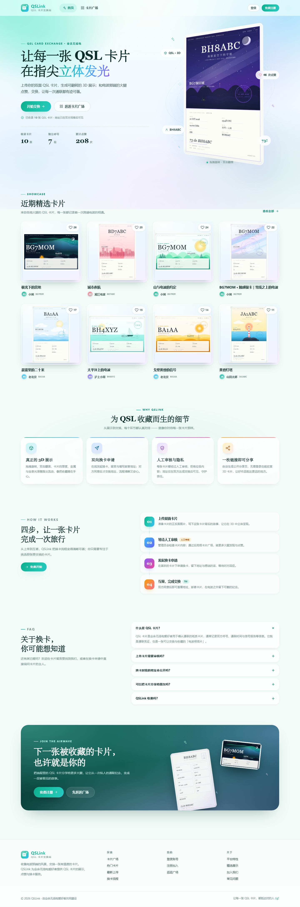

# QSLink · QSL 卡片交换站

> 让每一张 QSL 卡片，都抵达对的人。73!

QSLink 是一个为业余无线电爱好者（HAM）打造的 QSL 卡片交换社区：上传自己的双面 QSL 卡片，以可拖拽的 3D 方式欣赏，在广场里点赞收藏，提交换卡申请并与对方交换地址，管理员后台负责用户与卡片的人工审核。



## ✨ 功能总览

| 模块 | 能力 |
| --- | --- |
| 账户系统 | 注册 / 登录 / 退出、会话鉴权（7 天 Bearer Token）、密码 scrypt 加盐哈希、个人资料与收件地址、密码修改 |
| 卡片工坊 | 正反两面图片上传（PNG/JPEG/WebP/SVG，拖拽 + 预览）、自定义宽高比例（3:2 / 2:3 / 4:3 / 16:9 / 任意整数比）、标题 / 呼号 / 简介、实时 3D 预览、重新编辑 |
| 3D 展示 | 纯 CSS 3D 双面卡片：真实卡纸厚度、拖拽旋转 + 惯性、随指针流动的光泽、空闲自动旋转、双击翻转、触摸支持、任意比例不变形 |
| 卡片广场 | 按呼号搜索、最新 / 最热排序、分页、点赞（含彩纸动效）、分享链接 |
| 换卡流程 | 申请时填写地址与留言；卡片主人在"收到的申请"中同意 / 拒绝；同意后双方可见收件地址并复制；可标记完成；支持撤回与重新申请 |
| 分享链接 | 每张已审核卡片拥有独立公开链接 `/share/<token>`，未注册访客可直接查看 3D 卡片模型，并引导注册 / 登录后申请换卡 |
| 管理后台 | 数据概览、待审核卡片一键通过 / 拒绝、用户管理（编辑资料 / 角色 / 禁用 / 删除 / 重置密码）、卡片编辑与删除、换卡记录与地址查看 |
| 人工审核 | 新上传 / 用户修改后的卡片自动进入"审核中"，仅在管理员通过后出现在广场与公开分享页 |
| 视觉动效 | 清新薄荷 × 天蓝 × 淡紫渐变、玻璃拟态、漂浮光斑、滚动进场、数字滚动、磁吸按钮、水波纹、地图式点赞彩纸；尊重 `prefers-reduced-motion` |

## 🚀 快速开始

环境要求：**Node.js ≥ 18**（开发验证于 Node 24），零 npm 依赖、无需联网、无需构建。

```bash
cd qsl-card-exchange
npm start            # 启动服务，默认 http://127.0.0.1:8787
# 或开发模式（文件变化自动重启）
npm run dev
```

Windows 用户也可以直接**双击项目根目录的 `start.cmd`**：会自动启动服务并打开浏览器。

首次启动会自动创建 `data/db.json` 并写入演示数据（程序化生成的双面 SVG QSL 卡片示例，共 13 张）。

### 演示账号

| 角色 | 用户名 | 密码 | 说明 |
| --- | --- | --- | --- |
| 普通用户 | `bg7mom` | `Demo@123456` | 拥有 3 张示例卡片与完整换卡申请（待处理 / 已同意 / 已拒绝） |
| 管理员 | `admin` | `Admin@123456` | 可进入 `/admin` 审核卡片与管理用户 |
| 其他种子用户 | 见登录页提示 | `Demo@123456` | BA1AA / BD7ABC / BH4XYZ / BH8ABC / JA1ABC / K2XYZ |

### 重置演示数据

```bash
# 停止服务后删除数据文件与上传目录，再次启动即可重新生成种子数据
rm -rf data/db.json data/uploads
npm start
```

> 上传的卡片图片保存在 `data/uploads/`，数据保存在 `data/db.json`，可直接备份。

## ⚙️ 环境变量

| 变量 | 默认值 | 说明 |
| --- | --- | --- |
| `QSL_PORT` | `8787` | 监听端口 |
| `QSL_HOST` | `127.0.0.1` | 监听地址（局域网访问可设为 `0.0.0.0`） |
| `QSL_DATA_DIR` | `<项目>/data` | 数据目录（含 `db.json` 与 `uploads/`） |

## 🧪 测试

```bash
npm test             # 启动隔离实例跑完整 API 端到端冒烟测试（tests/smoke.mjs）
node tools/shot.mjs http://127.0.0.1:8787/ shot.png 1440 1000   # 无头浏览器截图
```

测试脚本会使用临时 `QSL_DATA_DIR` 与随机端口，不影响开发数据。

## 🗂 目录结构

```
qsl-card-exchange/
├── server/                 # 零依赖 Node.js 后端
│   ├── server.js           # HTTP 入口：API 路由 + 静态资源 + SPA 回退
│   ├── lib/                # 数据层、鉴权、校验、上传、领域路由
│   ├── seed.js             # 演示数据与程序化 SVG QSL 卡片生成
│   └── lib/                # 数据层、鉴权、校验、上传、领域路由
├── public/                 # 原生前端（无需构建）
│   ├── index.html
│   ├── css/                # base / components / gallery / flows / admin / animations
│   ├── js/                 # core / api / ui / effects / card3d / pages / app
│   └── assets/             # 品牌与插画 SVG
├── data/                   # 运行时数据（db.json + uploads/）
├── docs/                   # API 契约、前端契约、截图
├── tests/                  # 端到端冒烟测试
└── tools/                  # 截图工具
```

## 📚 文档

- [API 契约（唯一事实来源）](docs/API.md)
- [前端架构与设计系统契约](docs/CONTRACT.md)
- 自动化验收：`npm test`（由 tests/smoke.mjs 驱动隔离实例）

## 🎨 设计说明

- **色彩**：薄荷绿 `#0eaf8f` → 青 `#21c7b0` → 天蓝 `#38bdf8` 的品牌渐变，搭配珊瑚粉点赞色与淡紫背景光斑，整体明亮通透。
- **字体**：正文微软雅黑 / 苹方，呼号使用等宽字体强化"电台"气质，标题与 73 落款使用衬线体。
- **3D**：CSS `preserve-3d` 实现双面卡片与真实卡纸厚度（约 2-4px 侧边层），指针位置驱动高光角度，RAF 驱动惯性旋转与空闲自转，`ResizeObserver` 适配任意比例；无 WebGL 依赖，移动端可用。
- **动效**：进入视口渐显、数字滚动、按钮磁吸、点击水波纹、点赞心跳与彩纸、路由切换过渡；全部动画在 `prefers-reduced-motion` 下自动关闭。

## 🔐 安全与实现说明

- 密码使用 `crypto.scrypt` + 随机盐哈希存储，接口响应中永不返回哈希与盐。
- Token 为 32 字节随机值，服务端 `sessions` 表校验有效期；被禁用用户立即失效。
- 所有卡片、申请、用户管理接口均做所有权 / 角色校验；管理员保护规则（不能禁用自己或最后一个管理员、不能删除最后一个管理员）。
- 前端所有用户内容插值均转义，避免 XSS；上传仅接受图片 MIME 白名单并限制大小（单图 ≤ 8MB，请求体 ≤ 25MB）。
- 数据层为 JSON 文件 + 原子写（临时文件 + rename）+ 写入串行队列，适合演示与小型自托管；大规模生产建议替换为 SQLite / PostgreSQL 并接入对象存储与 HTTPS。

## 📸 截图

`docs/screenshots/` 下为交付时的真实运行截图（桌面 1440px + 移动端 390px，由 `node tools/final-shots.mjs` 生成）：

| 文件 | 内容 |
| --- | --- |
| `home.png` | 首页 Hero 3D 卡片与统计数据 |
| `explore.png` | 卡片广场：呼号搜索 / 热门排序 |
| `detail.png` | 卡片详情：3D 查看器 + 换卡申请 |
| `share.png` | 公开分享页（未登录访客视角） |
| `exchanges.png` | 换卡申请：收到的申请 / 我发出的申请 |
| `card-editor.png` | 上传卡片：正反面上传 + 比例 + 实时 3D 预览 |
| `admin-overview.png` / `admin-cards.png` | 管理后台概览与卡片人工审核 |
| `admin-users.png` / `admin-exchanges.png` | 用户管理 / 换卡记录（含地址） |
| `home-mobile.png` / `explore-mobile.png` / `detail-mobile.png` / `dashboard-mobile.png` | 移动端适配 |
| 其他 | `login.png`、`register.png`、`dashboard.png`、`my-cards.png`、`profile.png` |

## ✅ 验收

- 后端 API：`npm test` → **128 项检查全部通过**（注册登录 / 卡片 / 点赞 / 换卡状态机 / 地址可见性 / 分享 / 管理后台 / 权限边界 / 413 与 XSS 边界等）。
- 前端：桌面与真机 390px 视口共 **40 张截图**逐张视觉验收；20 条路由控制台 0 报错、移动端无横向溢出、页面无「波段/模式」字样。
- v3.1 最终调整：首页 Hero 展示社区示例卡片（不含个人真实照片）、卡片广场仅按呼号搜索、上传/展示/后台不再包含波段与模式字段、3D 卡片厚度修正为真实卡纸厚度（2-4px）。
- 详细验收记录见 [`qa-report.md`](qa-report.md)。

© 2026 QSLink · 由业余无线电爱好者共同建设 · 73!
